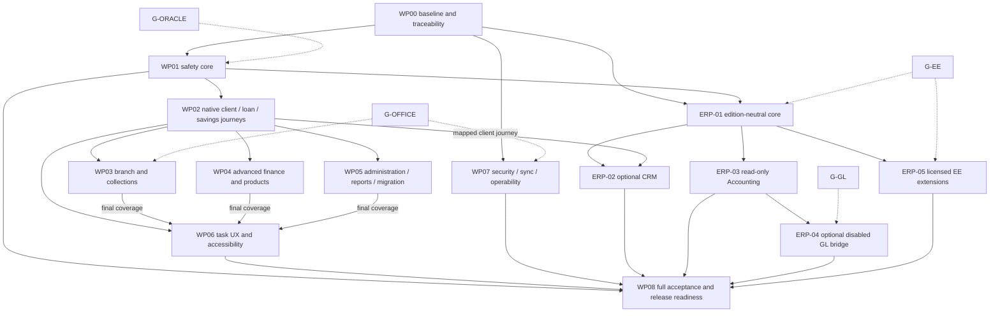

# MFIERP work package dependency plan

This is the WP00 execution plan for [master issue #5](https://github.com/nandahtoon/MFIERP/issues/5), extended by [ERP issue #6](https://github.com/nandahtoon/MFIERP/issues/6). It records observed evidence and proposed implementation order, not workflow acceptance, a signed scope exclusion, or release authorization. Read the [master specification](../CODEX_MASTER_IMPLEMENTATION_SPEC.md), [acceptance matrix](../PARITY_ACCEPTANCE_MATRIX.md), [ADR 001](../ARCHITECTURE.md), [ADR 002](../ODOO_20_EDITION_CRM_ACCOUNTING_ADR.md) and [AGENTS.md](../../AGENTS.md) together.

## Frozen planning baseline

Snapshot reviewed on 2026-11-19. Recheck branch, source pins, issues and CI before each increment; do not silently substitute a newer source or transfer old test results to a new commit.

| Item | Exact reference and evidence boundary |
| --- | --- |
| Local MFIERP implementation | Branch `feat/odoo20-mifos-native`, commit [`3df083bc335280445a0679b79454b509eab6801e`](https://github.com/nandahtoon/MFIERP/commit/3df083bc335280445a0679b79454b509eab6801e), addon `20.0.9.0.0`. At inspection, `addons/mfierp/tests/test_workspace.py` also had an uncommitted test change; it is outside this frozen commit. |
| Master mandate | [`57c2313a1e2e375baff8d6ad2ff4f12e448424fe`](https://github.com/nandahtoon/MFIERP/commit/57c2313a1e2e375baff8d6ad2ff4f12e448424fe), amended by the CE/EE/CRM/Accounting decision at [`8d4d22eaea6caaed28a98a801bd0596907cc0d3a`](https://github.com/nandahtoon/MFIERP/commit/8d4d22eaea6caaed28a98a801bd0596907cc0d3a). The amendment overrides earlier Community-only target language. |
| GitHub implementation context | [PR #1](https://github.com/nandahtoon/MFIERP/pull/1) was open, Draft and unmerged; its observed remote head was `8d4d22eaea6caaed28a98a801bd0596907cc0d3a`. It was behind the local implementation commit. |
| CI evidence observed | [Run 44638491473](https://github.com/nandahtoon/MFIERP/actions/runs/44638491473) reported success for `8d4d22eaea6caaed28a98a801bd0596907cc0d3a`. No PR-triggered run for local `3df083bc335280445a0679b79454b509eab6801e` was returned by the connector query; this is not a claim about every workflow event. Re-query exact-head CI after the implementation/evidence commit is published. |
| Local validation record | [VALIDATION.md at the implementation baseline](https://github.com/nandahtoon/MFIERP/blob/3df083bc335280445a0679b79454b509eab6801e/docs/VALIDATION.md) records 64 pure tests and 59 Odoo tests on clean install and upgrade. Business API calls were mocked. This plan did not rerun or independently certify those results, and they do not establish Oracle UAT or EE support. |
| Functional source | Owner's [Mifos X source](https://github.com/nandahtoon/Mifosx-web-app/tree/34c7f278861ef25052f2e00d106d8527f5d270d3), revision `34c7f278861ef25052f2e00d106d8527f5d270d3`. The [literal-call inventory](mifos-endpoints.json) supplies pinned source paths and line links; it is not a complete screen/action inventory. |
| Backend behavior reference | [Apache Fineract](https://github.com/apache/fineract/tree/6a28754c6839fa64f5faf1873f9fcb52bc330fd9), revision `6a28754c6839fa64f5faf1873f9fcb52bc330fd9`. Reviewed source is not proof that Oracle runs that clean build. |
| Published API snapshot | Fineract `1.16.0-SNAPSHOT`; canonical source SHA-256 `a2facc90a00b71379a3c4261fd1529c5c7ccfff2847dc1179b518124c40e4fb5`, recorded in [catalog.json](../../addons/mfierp/services/catalog.json) and the call inventory. |
| Framework reference | [Odoo 20 source](https://github.com/odoo/odoo/tree/c40402fab8c1509f3c68cd9cc5140f7790611d99), revision `c40402fab8c1509f3c68cd9cc5140f7790611d99`, used by the documented local CE runtime. [Odoo 19](https://github.com/odoo/odoo/tree/11847c6348e378546fcd1298b8c6e0bd36f3565d) is a migration reference only. No licensed EE source/runner revision or EE pass is recorded. |

The current inventory records 1,097 static contracts, 945 typed and 152 blocked; 720 literal frontend calls comprise 666 typed candidates, 26 source-contract gaps, 25 computed-resource review items and three unpublished-route gaps. The mandate's 1,094/942 and 662/30 figures are historical checkpoints. Neither set measures operator parity, verified financial behavior or accepted workflows. Every workflow/UAT flag in the existing call inventory remains unverified. WP00 must reconcile these inputs into the row-per-action matrix without promoting a row merely because its API matches.

## Published implementation checkpoint — 2026-11-20

The frozen planning snapshot above is retained as history. The integrated implementation is now published at [`6bf1b64dedebd0470f8d5bbb76b6b298ebebac5e`](https://github.com/nandahtoon/MFIERP/commit/6bf1b64dedebd0470f8d5bbb76b6b298ebebac5e), on the same branch and still in Draft PR #1. Its exact-head [CI run 44745924805](https://github.com/nandahtoon/MFIERP/actions/runs/44745924805) passed. The tracked implementation baseline passed 64 pure tests and 62 CE Odoo tests on both clean installation and upgrade; business API calls were mocked. Clean installation used `mfierp_test_wp00_baseline_clean`, and upgrade used `mfierp_test_expanded`, in the isolated MFIERP project. These results do not establish EE support, office-policy acceptance or authenticated Oracle financial UAT.

The new [functional matrix](FULL_FUNCTIONAL_MATRIX.csv) contains 8,062 evidence obligations, including 748 source screens. Its 8,022 automatically extracted rows remain `NOT_MAPPED`; 40 curated rows add 25 owner requirements, 11 `SOURCE_MAPPED` workflows and four `RED_APPROVAL_BLOCKED` gates. Total statuses are 8,047 `NOT_MAPPED`, 11 `SOURCE_MAPPED` and four `RED_APPROVAL_BLOCKED`. No row is operator-accepted or live-UAT-passed. These are extraction and review obligations, not a count of distinct features or an approved completion denominator. See [matrix reproduction and gap triage](README.md#wp00-functional-inventory) for provenance, limitations and domain counts. WP00 source inventory and semantic triage remain open; the next local safety increment may proceed without treating that inventory as approved.

## Evidence states and hard gates

Use the workflow states from master section 4: `NOT_MAPPED`, `SOURCE_MAPPED`, `CONTRACT_VERIFIED`, `IMPLEMENTED`, `LOCAL_TEST_PASS`, `STAGING_UAT_PASS`, `OPERATOR_ACCEPTED`, `NOT_APPLICABLE_APPROVED`, `UPSTREAM_BLOCKED`, `RED_APPROVAL_BLOCKED`. Each state applies to an evidenced workflow row, not an entire domain inferred from a directory. Keep `CI_GREEN`, runtime acceptance, live UAT and owner release authorization as separate evidence dimensions. Missing evidence stays missing; a reviewer or approval role named below is a requirement, not an assigned person or a signature.

| Gate | Observed state | Required evidence to open the gate | What can proceed locally |
| --- | --- | --- | --- |
| G-ORACLE: clean provenance and approved synthetic acceptance | `RED_APPROVAL_BLOCKED` for live writes; [issue #2](https://github.com/nandahtoon/MFIERP/issues/2) remains open. [Oracle evidence](../ORACLE-STAGING.md) reports historical `dirty=true` and unavailable trusted authenticated access from this workstation. | MicroOps-Infra handoff with exact clean version/full SHA, explicit `dirty=false`, TLS/tenant/service permissions and synthetic product/staff/office prerequisites; separately authorized test scope, expected effects, recovery and sanitized evidence. Historical [authenticated evidence](https://github.com/nandahtoon/MFIERP/issues/2#issuecomment-7023375934) is not current acceptance. | Source review, mock contracts, isolated local fixtures, failure/reconciliation tests and an executable UAT procedure. Preserve dispatch refusal; no trust bypass, credential change, Oracle deployment, tenant creation or business writes. |
| G-OFFICE: approved segregation policy | `RED_APPROVAL_BLOCKED` for production office-policy implementation/acceptance; [issue #3](https://github.com/nandahtoon/MFIERP/issues/3) remains open. Current isolation is company-wide. | Domain-approved office hierarchy, head-office/multi-office exceptions, shared group/center records, user assignments, transfer behavior and independent Odoo/Fineract security review. No approval is recorded here. | Inventory relationship paths, threat cases and policy decision fixtures. Do not grant new visibility or invent a blanket branch rule. |
| G-EE: licensed edition runner | `EE_NOT_TESTED`; [issue #6](https://github.com/nandahtoon/MFIERP/issues/6) remains open. Core manifest is `base`/`web` only; this is dependency evidence, not EE runtime evidence. | Licensed EE source/dependencies, pinned runner and independent clean install/upgrade/uninstall, workflow, security and browser results. | CE portability/optional-app tests, edition capability probes and runner design without proprietary source or credentials in the repository. |
| G-GL: financial ownership and bridge approval | `RED_APPROVAL_BLOCKED`; no signed bridge policy, accountant approval or bridge UAT is recorded. | Owner and independent senior accountant sign the ledger/consolidation boundary, account/journal/date/currency/office mapping, no-double-counting rules, dedupe/reversal controls and separately authorized synthetic UAT. | Read-only mapping/reconciliation design and non-posting fixtures. No bridge posting implementation or enablement before the signed policy; normal independent Odoo ERP transactions remain separately owned by Odoo. |

Fineract retains balances, schedules, allocation, interest, charges, transactions and its ledger. No work package authorizes merge, deployment, other-repository edits or new remote financial writes. No exclusion or owner signoff is invented to close a gate.

## Dependency graph

Solid arrows are implementation prerequisites, except edges explicitly labeled `final coverage`, which gate final coverage rather than the start of UX work. Dashed arrows are external acceptance gates: they block the affected package's acceptance, while explicitly independent local work may continue. WP01 is a continuing safety prerequisite, not a one-time waiver. WP06 begins with the mapped WP02 journeys and iterates alongside WP03-WP05; WP07 also runs throughout feature increments.

ERP-04 is conditional: an explicit signed owner exclusion can leave the bridge disabled and excluded from approved scope. Until such a decision exists, it remains unresolved and must not be counted as delivered. Financial acceptance for WP02-WP05 and remote CRM/Accounting flows also inherits G-ORACLE. Branch-sensitive ERP and feature acceptance inherits G-OFFICE. Full CE+EE acceptance inherits G-EE even when no EE-only enhancement is selected.

## Prioritized packages and deliverables

No package is declared complete by this plan. Existing tested building blocks are preserved; missing journeys, negative paths and acceptance evidence remain visible.

| Package | Priority, dependencies and current evidence | Next deliverable and exit evidence |
| --- | --- | --- |
| WP00 BASELINE/TRACE | P0; first. Existing pinned literal-call inventory is `SOURCE_MAPPED`; complete source-action/role denominator and accepted scope are not established. | Produce `FULL_FUNCTIONAL_MATRIX.csv` with stable per-screen/action/negative/reversal IDs, source path/line, operator goal, API conditions, Odoo context, security, side effects, tests, blockers and acceptance references. Enumerate all D01-D20 and ERP paths. Reconcile historical/current counts and triage every unsupported/computed/unpublished case. Validate links/status rules; obtain actual scope decisions without fabricating exclusions. |
| WP01 SAFETY CORE | P0; WP00 baseline. Implemented local components include immutable payloads, independent approvals, durable reservation, dispatch/reconciliation serialization, runtime pins/clean-build check, scoped scheduler reconciliation and audit minimization. Local mocked evidence exists; G-ORACLE remains closed. | Close remaining safety semantics and race/identity cases against source, including the distinction between response receipt and independently verified financial outcome. Preserve unknown-outcome non-replay and remote maker/checker identity separation. Attach exact-head local/CI evidence and independent review; live closure requires issue #2 UAT and remote ledger/recovery evidence. |
| WP02 VERTICAL SLICE | P1; WP00 + applicable WP01 controls. Core focused operations exist, but complete journeys remain unverified. This is an intermediate gate, not project completion. | Client/KYC to loan application, approval, disbursement, repayment/reversal, balance/schedule/GL/report verification; equivalent savings lifecycle. Add template/reference choices, source currency/business dates, status/role guidance and explicit recovery. Local role/browser tests first; authorized synthetic read-after-write and operator acceptance later. |
| WP03 BRANCH OPERATIONS | P1; WP02 + relevant WP07 controls; G-OFFICE and G-ORACLE for acceptance. Membership, meetings, scoped attendance and individual collections have local building blocks. Cash custody/day-close and joint workflows are not fully mapped. | Map group/center/JLG relationships, source-supported bulk/partial-failure collection and cash handoff procedures. Require approved cash/ledger ownership before designing day-close effects; never invent a cash ledger. Verify per-account effects, transfers and forbidden office references. |
| WP04 PRODUCTS/ADVANCED FINANCE | P1/P2 by financial risk; WP02 + WP01 and per-row source/product prerequisites. Selected deposit, share, charge, standing-instruction and provisioning contracts exist; complete product journeys are unverified. | Close prioritized advanced-loan, tranche/settlement, collateral/guarantor, deposit, shares/dividend and transfer lifecycles with conditional templates and reversal paths. Keep Fineract calculations authoritative. Each row needs negative tests, remote schedule/transaction/GL evidence and domain review. |
| WP05 ADMIN/REPORT/MIGRATION | P1/P2 by operator dependence; WP02 + WP01. Selected administration, metadata audit, protected files and registered datatable entries exist; full KYC/survey/import/report flows are incomplete. | Source-map configuration, surveys, schema/inline data, safe report parameters/exports and bounded import preview/per-row results. No arbitrary SQL/payload console. Remote checker decisions remain blocked without independently verified remote identity. Migration execution requires approved synthetic scope and reconciliation/compensation evidence. |
| WP06 UX/ACCESSIBILITY | P1 alongside WP02-WP05; final coverage after those journeys. Existing browser evidence is limited synthetic smoke coverage. | Remove day-to-day dependence on generic contract selection; contextual native actions/options, My Tasks and usable exceptions/freshness. Prove named-role completion, keyboard/focus, 200% zoom, mobile/tablet, empty/loading/error states with source-linked browser evidence. |
| WP07 SECURITY/PERFORMANCE/OPERABILITY | P0/P1 alongside feature work; WP00, [issue #3](https://github.com/nandahtoon/MFIERP/issues/3), [issue #4](https://github.com/nandahtoon/MFIERP/issues/4). Current sync is atomic across resources with bounded pages; no per-resource checkpoint/resume guarantee. | Implement source-supported bounded per-resource progress/failure isolation, last-success and detail freshness, deterministic concurrent upsert and documented retention/deletion fallback. Test >10k synthetic records, failures/rate limits/concurrency and resume. Office enforcement waits for G-OFFICE. Add restore/dispatch reconciliation drills, monitoring and install/upgrade/rollback/support evidence without touching other services. |
| WP08 ACCEPTANCE/READINESS | Final; all approved WP/ERP obligations, independent reviews and external gates. No full-parity, live financial UAT or release acceptance exists. | Every approved in-scope row is `OPERATOR_ACCEPTED`, or has an actual signed exclusion; zero untriaged gaps, exact-head CI, both editions, reconciled synthetic UAT, security/domain review, accessible operator journeys, measured capacity and recovery/license/runbooks. Separate owner release and Infra promotion authorizations are still required. |
| ERP-01 / WP-ERP-01 | P1 parallel foundation; WP00 + WP01. Current core has no CRM/account/EE hard dependency; CE local test evidence exists, EE is untested. | Verify optional-app absence and CE core install/upgrade/uninstall, preserve source/license separation, then run the same obligations on licensed EE. Record edition-specific results; dependency neutrality alone cannot earn `EE_CORE_PASS`. |
| ERP-02 / WP-ERP-02 | P2 after ERP-01 local foundations and mapped client journey; not implemented. | Optional `mfierp_crm`: explicit company/partner/tenant/client crosswalk, consent evidence, verification timestamp, uniqueness/conflict resolution and contextual ACL. CRM Won never creates/activates a remote client. Test ambiguous identities, relinking, CRM-only PII denial and independent approval for remote onboarding. Office-policy and live acceptance gates remain. |
| ERP-03 / WP-ERP-03 | P2 after ERP-01; not implemented. | Optional `mfierp_account`: detect actual CE/EE account capability; read-only mapped Fineract GL/trial balance versus Odoo summaries with source/date/currency/office and discrepancy evidence. No `account.move` side effects. Earn `ERP_GL_RECONCILED` only from independently reviewed comparisons, not mocked display tests. |
| ERP-04 / WP-ERP-04 | RED; ERP-03 + G-GL + authorized UAT. Not implemented; disabled by default. | After signed policy only, design/implement balanced summarized batches, deterministic source keys, dedupe, accountant dual control, closed-period/FX validation, discrepancy quarantine and controlled reversals. Prove no duplicated portfolio accounting, no financial echo and no ambiguous-result replay. No enabled posting or bridge acceptance is assumed. |
| ERP-05 / WP-ERP-05 | P2; ERP-01 + G-EE and relevant optional adapters. Not implemented. | Select only source-verified licensed enhancements and narrow dependencies. Run genuine EE-only tests plus CE absence/install/uninstall regressions. Keep proprietary source/assets out of core/repository and record missing EE functionality honestly. |

## Next genuinely unblocked increments

1. **Continue WP00 semantic triage before widening feature scope.** The generated screen/action/review rows and curated requirements now exist. Review cross-file semantics, computed routes, source feature flags, source-supported reversals and negative paths; consolidate obligations into owner-reviewable end-to-end workflows. Preserve unknowns as `NOT_MAPPED` or the evidenced blocked state. Neither the domain table, extraction row count nor API count establishes an approved denominator.
2. **WP01 local verification semantics.** Map financial command response receipt, remote maker/checker pending and authoritative readback separately. Current generic dispatch can set `done` from a `resourceId` alone; this is not master section 7 financial verification. Define the source-backed readback/reconciliation transition and test success, stale read, malformed IDs, lost response, concurrent reconcile and non-replay locally before any remote acceptance.
3. **WP07 read-only sync reliability from issue #4.** Start with per-resource last-success/failure evidence and a bounded checkpoint design using reviewed API capabilities. Use isolated synthetic fixtures for partial failures and concurrent refresh. Retain historical snapshots where deletion semantics are unapproved; do not invent incremental filters for APIs that lack them. No financial write or new office privilege is required.
4. **ERP-01 CE portability and absence tests.** Verify core install/upgrade/uninstall with optional apps absent in the isolated project, and document actual CE CRM/account capabilities from the pinned source. Prepare an EE evidence lane without pretending it ran. Do not make core depend on either adapter.
5. **WP02/WP06 a narrow contextual task increment.** Select a mapped client/loan/savings row, replace free numeric reference entry with source-backed template choices, and cover role/status/currency/freshness and keyboard/browser recovery using local synthetic data. Remote outcomes remain `STAGING_UAT_PASS`-unverified until G-ORACLE is satisfied.

WP03-WP05 and ERP-02/03 may advance independent source analysis and local work after their mapped prerequisites. Do not force-block all repository work on Oracle, but do not use local progress to bypass office, finance, EE or release decisions.

## Evidence handoff for each increment

Record the exact MFIERP commit/tree, framework/edition and Fineract source/runtime pins, affected matrix IDs, reviewed source/API links, commands/test-run results, isolated database/project, relevant browser evidence, independent reviewer reference and unresolved gates. Distinguish documents that describe a test from logs that prove it ran. Never carry `CI_GREEN` from `6bf1b64` or local pass counts to a later unverified head.

Keep PR #1 Draft and report goal, outcome, exact commit/CI, matrix delta, independent review, live UAT state, blockers and next unblocked task. Release remains prohibited until master section 12 and the edition-specific ADR gates are met. This plan creates no new approval, assignee, deployment or financial authority.
